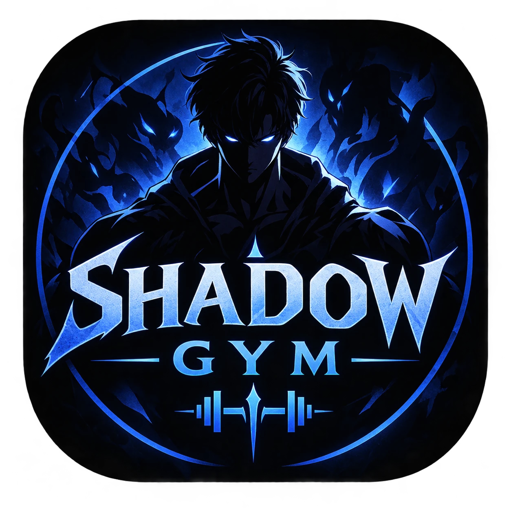

# Shadow Gym

**Level up in real life.** A fitness tracker that turns your workouts into a Solo-Leveling-style RPG.

*Android · Kotlin · Jetpack Compose · offline-first*

---

## What is Shadow Gym?

Shadow Gym treats your training like a game: every workout is a **quest**, every set earns **XP**, and your real-life progress raises your **attributes**, **level** and **class**. The "System" guides you from your first awakening assessment to prestige classes – and everything stays on your phone.

## Features

- ⚔️ **Quests & workouts** – daily and weekly quests, rest timer, sets/reps tracking, custom exercises with images
- 📈 **Levels, XP & attributes** – STR, VIT, PER and more grow with the way you train
- 🧙 **Classes & prestige classes** – unlock base classes by raising attributes; your title evolves with your class level
- 🗡️ **Armory & shop** – 140+ items of equipment that boost your attributes, earned with gold from your quests
- 🏰 **Dungeons, events & trophies** – achievements and seasonal challenges to keep you going
- 🌙 **Sleep, nutrition & body measurements** – the whole picture, not just the gym
- 🔔 **Reminders** – daily notifications at the times you choose
- 💾 **Backup & restore** – export your complete progress to a JSON file
- 🌍 **Multilingual** – English, Deutsch, Español, Français, Português
- 🔒 **Private by design** – your data stays on your device

## Status

Shadow Gym is under active development and not yet publicly released. This repository is the home for **feedback, bug reports and feature requests**. The source code itself is proprietary and lives in a private repository.

## Report a bug or request a feature

You can reach this page straight from the app: **Settings → Feedback & ideas**.

1. You need a free [GitHub account](https://github.com/signup).
2. Open a [new issue](https://github.com/charichu/shadow-gym-issues/issues/new/choose) and pick **Bug report** or **Feature request**.
3. Describe what happened or what you'd like to see – screenshots are very welcome.

Before opening an issue, please take a quick look at the [existing ones](https://github.com/charichu/shadow-gym-issues/issues) – maybe it's already there, and you can add a 👍 or a comment.

Every report helps. **Thank you for supporting Shadow Gym!**

## License

Shadow Gym is proprietary software © 2026 David Vennemeier. All rights reserved. This repository contains only documentation and the issue tracker; no license to the app's source code or assets is granted.
